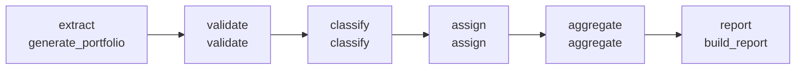

# RWA Calculator — Basel III / CRR3 Standardised Approach

A config-driven Python pipeline that computes credit-risk **risk-weighted assets (RWA)** and the Pillar 1 own-funds requirement under the **CRR3 standardised approach** (Regulation (EU) 575/2013 as amended by Regulation (EU) 2024/1623, implementing the Basel III finalisation, BCBS d424).

It runs end-to-end on a synthetic loan book — generation, validation, exposure-class resolution, risk-weight assignment, aggregation and a Markdown report — and every decision it makes is written back to the data as an audit column.

> All figures are produced from a synthetic portfolio and are illustrative only.

---

## Design principles

- **Rules in YAML, engine in Python.** No risk weight, threshold or distribution parameter is hardcoded. The regulatory rule-book lives in `config/risk_weights.yaml`; the portfolio and thresholds live in `config/portfolio.yaml`. Change the YAML, change the result.
- **Fully auditable.** Each exposure carries the validation flags it tripped, the classification rule that fired, the exposure class it landed in, the risk weight applied and the exact table/bucket that produced it.
- **Validator-first.** Bad data is caught before it is priced. The synthetic generator deliberately injects defects that map one-to-one onto validator checks, so the data-quality stage is exercised on every run.
- **Conservative by default.** Missing or unrecognised ratings fall back to `unrated`; unpriceable classes fall back to the `other` weight and are tagged in the audit trail rather than failing silently.

---

## Pipeline



| Stage | Module | What it does |
|---|---|---|
| **extract** | `extraction/case_generator.py` | Generates a reproducible synthetic book from `portfolio.yaml` (or load a CSV instead). |
| **validate** | `transformation/validator.py` | Runs exclusion and flag checks, corrects DPD/default inconsistencies, marks unpriceable rows. |
| **classify** | `transformation/classifier.py` | Resolves each exposure to a CRR3 exposure class via ordered precedence rules. |
| **assign** | `transformation/risk_weight.py` | Looks up the SA risk weight and computes `rwa = ead_after_crm × risk_weight`. |
| **aggregate** | `aggregation/aggregator.py` | Totals RWA, capital requirement, RWA density and breakdowns by class and rating. |
| **report** | `reporting/report.py` | Renders a GitHub-flavoured Markdown report. |

`pipeline.py` orchestrates all six stages.

---

## Quick start

Requirements: Python ≥ 3.10, `pandas`, `numpy`, `pyyaml`.

```bash
git clone https://github.com/MikhailAleinikov/RWA-Calculator-Basel-III.git
cd RWA-Calculator-Basel-III
pip install pandas numpy pyyaml

# generate a book, run the full pipeline, write outputs
PYTHONPATH=src python -m rwa.pipeline
```

This writes:

- `data/processed/portfolio_priced.csv` — the per-exposure, fully audited frame
- `reports/rwa_report.md` — the capital report

and prints a headline summary to the console.

### CLI options

```bash
PYTHONPATH=src python -m rwa.pipeline \
    --n 10000 --seed 7 \            # override book size / RNG seed
    --clean \                       # disable defect injection
    --own-funds 1.6e9 \             # compute capital ratio and surplus/shortfall
    --min-ratio 0.08 \              # Pillar 1 minimum (default 8%)
    --market-rwa 0 --operational-rwa 0 \
    --out-dir reports
```

| Flag | Meaning |
|---|---|
| `--config PATH` | Alternative `portfolio.yaml` |
| `--from-csv PATH` | Price an existing CSV instead of generating one |
| `--n`, `--seed` | Override number of exposures / RNG seed |
| `--clean` | Generate without injected data defects |
| `--market-rwa`, `--operational-rwa` | Scalar add-ons to the RWA base (default 0 → credit-only view) |
| `--own-funds` | Own funds for the capital ratio and headroom |
| `--min-ratio` | Minimum capital ratio (default 0.08) |
| `--out-dir` | Report output directory |
| `--no-write` | Compute only, write nothing |

Generate a portfolio on its own:

```bash
PYTHONPATH=src python -m rwa.extraction.case_generator --out data/raw/portfolio.csv
```

### Python API

```python
from rwa import run_pipeline

out = run_pipeline(own_funds=1.6e9, write=False)
print(out.result.headline())

out.result.by_class        # RWA / density / capital per exposure class
out.portfolio.head()       # per-exposure audit frame
```

Stages can also be composed by hand:

```python
from rwa import generate_portfolio, validate, classify, assign, aggregate

priced = assign(classify(validate(generate_portfolio(n=500, inject_dirt=False))))
result = aggregate(priced)
```

`import rwa` is lazy (PEP 562): sub-packages are only imported when a public name is first accessed.

---

## Methodology

### 1. Synthetic portfolio

The generator follows a **"draw the driver first"** dependency order so that correlated fields stay consistent:

```
counterparty_type → EAD scale (lognormal per type) + rating distribution
property_value    → loan_amount (via beta-distributed LTV) → overwrites EAD for real-estate rows
external_rating   → PD anchor + default likelihood
```

Real-estate-secured rows are split into residential and commercial. Non-RE rows may carry financial collateral. Defaulted rows receive PD = 1 and 90+ days past due; a small tail of performing rows carries short arrears.

### 2. Validation

| Check | Kind | Condition |
|---|---|---|
| `bad_ead` | exclusion | EAD ≤ 0 or missing |
| `re_value_invalid` | exclusion | RE row with missing or non-positive property value |
| `bad_maturity` | exclusion | maturity ≤ 0 or missing |
| `pd_oob` | flag | PD outside [0, 1] |
| `lgd_oob` | flag | LGD outside [0, 1] |
| `missing_rating` | flag | external rating missing |
| `high_ltv` | flag | RE row with LTV > 100% |
| `dpd_default_mismatch` | flag | DPD above the default threshold but not flagged as defaulted — **corrected** to defaulted |

Excluded rows stay in the output frame with `NaN` RWA and are reported separately (count and EAD), so nothing disappears from the audit trail.

### 3. Exposure classification

Ordered predicate rules, **first match wins**, following CRR3 precedence — default status overrides everything, real-estate security overrides the counterparty class, then the counterparty hierarchy:

| # | Rule | Exposure class |
|---|---|---|
| 1 | defaulted flag **or** DPD > threshold | `defaulted` |
| 2 | secured by residential property | `residential_real_estate` |
| 3 | secured by commercial property | `commercial_real_estate` |
| 4 | sovereign / central bank | `sovereign` |
| 5 | institution / bank | `institution` |
| 6 | retail/SME obligor ≤ retail size cap | `retail` |
| 7 | corporate, **or** retail/SME obligor above the cap (spillover) | `corporate` |
| 8 | natural person | `individual` |
| — | no rule matched | `other` |

The default DPD threshold and retail size cap are read from `portfolio.yaml → thresholds`. Class names match the keys of `risk_weights.yaml` exactly, so assignment needs no translation layer.

### 4. Risk-weight assignment

Three lookup strategies, chosen by exposure class:

| Classes | Axis | Lookup |
|---|---|---|
| sovereign, institution, corporate, retail, individual, other | external rating | `by_class_rating[class][rating_bucket]` |
| residential / commercial real estate | loan-to-value | `by_class_ltv[class][ipre \| non_ipre][ltv_bucket]` |
| defaulted | collateral | `defaulted[residential \| commercial \| unsecured_or_unknown]` |

Real estate uses the **whole-loan LTV-bucket treatment with the IPRE / non-IPRE split** introduced by the Basel III finalisation, rather than the legacy flat Basel II weights. RE rows with a non-computable LTV fall back to a configured conservative weight.

Audit columns added per exposure:

| Column | Content |
|---|---|
| `risk_weight` | decimal SA weight applied (0.20 = 20%) |
| `risk_weight_source` | table, branch and bucket that produced it, e.g. `by_class_ltv[residential_real_estate][non_ipre][ltv<=0.60]` |
| `ead_after_crm` | EAD entering the RWA product |
| `rwa` | `ead_after_crm × risk_weight` |

### 5. Aggregation

`aggregate()` returns a `CapitalResult` with total EAD, credit RWA, optional market/operational add-ons, total RWA, RWA density, the capital requirement (`min_ratio × total RWA`), and — if own funds are supplied — the capital ratio and surplus/shortfall. Breakdowns by exposure class and by rating include count, EAD, RWA, density, capital and RWA share.

The aggregator is approach-agnostic: it sums whatever `rwa` column it receives, so a future floored IRB/SA figure drops in without changes.

---

## Project structure

```
RWA-Calculator-Basel-III/
├── config/
│   ├── portfolio.yaml          # synthetic-book distributions, defect counts, thresholds
│   └── risk_weights.yaml       # CRR3 SA rule-book
├── data/
│   ├── raw/                    # generated portfolios
│   └── processed/              # priced, audited output
├── reports/                    # Markdown capital reports
└── src/rwa/
    ├── __init__.py             # lazy public API
    ├── pipeline.py             # orchestrator + CLI
    ├── extraction/
    │   └── case_generator.py
    ├── transformation/
    │   ├── validator.py
    │   ├── classifier.py
    │   └── risk_weight.py
    ├── aggregation/
    │   └── aggregator.py
    └── reporting/
        └── report.py
```

---

## Scope and limitations

- **Credit risk, standardised approach only.** No IRB leg yet.
- **Output floor not applied.** The 72.5% floor (`max(RWA_IRB, 0.725 × RWA_SA)`) only binds for banks using internal models; it is meaningless on an SA-only book and is planned alongside the IRB leg.
- **Credit risk mitigation.** Only funded real-estate collateral is modelled, via the LTV tables. Guarantees, credit derivatives and financial-collateral haircuts are out of scope, so `ead_after_crm` equals the booked exposure amount.
- **IPRE branch.** The engine supports income-producing real estate, but the generator does not yet emit an IPRE flag, so all RE exposures currently take the non-IPRE path.
- **Retail size cap** is tested per row; the generator produces one exposure per obligor, so no aggregation to the obligor level is performed.
- **Other CRR3 classes** (equity, covered bonds, securitisation, etc.) are out of scope and fall back to `other`.

---

## Roadmap

- [ ] Test suite (`pytest`), including the dirt-injection → validator loop and per-class risk-weight cases
- [ ] `pyproject.toml` packaging (removes the `PYTHONPATH=src` prefix)
- [ ] IPRE flag in the generator to exercise the IPRE LTV branch
- [ ] Phase two: F-IRB / A-IRB leg (ASRF / Vasicek risk-weight function) and the CRR3 output floor with transitional phase-in
- [ ] Optional Streamlit dashboard

---

## References

- Regulation (EU) 2024/1623 (CRR3), amending Regulation (EU) No 575/2013 (CRR)
- BCBS, *Basel III: Finalising post-crisis reforms* (d424), December 2017
